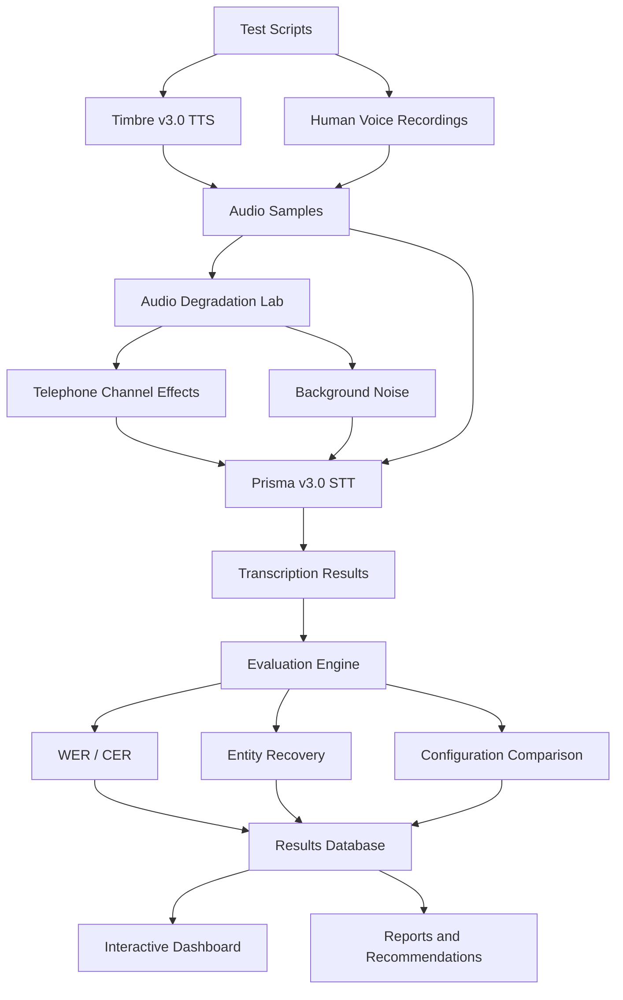

# Kasauti (कसौटी) — Indic Voice AI Stress-Test Lab

**Testing how reliably voice AI understands Indian languages under real-world audio conditions.**

Kasauti is an Indic Voice AI evaluation platform built using **Gnani AI's Timbre v3.0 (Text-to-Speech)** and **Prisma v3.0 (Speech-to-Text)** APIs.

It generates or accepts speech samples, applies audio degradation such as telephone-channel effects and background noise, evaluates speech recognition results, and highlights errors in important information such as names, phone numbers, OTPs, and financial amounts.

## 🎥 Demo Video

<!-- Replace the placeholder below with your public LinkedIn, YouTube, or other demo video URL. -->

**Watch the Kasauti application demo:**  


https://github.com/user-attachments/assets/6be8831d-49b5-4d26-844d-bdcbe7b882d5


The demonstration covers the dashboard, audio testing workflow, evaluation metrics, and transcription failure analysis.

## 🚩 Problem Statement

Voice AI systems are increasingly used in customer support, banking, financial services, and other enterprise applications.

However, speech recognition can become less reliable when dealing with:

- Regional Indian languages and code-mixed speech.
- Telephone-quality audio and background noise.
- Names, numbers, OTPs, and financial amounts.
- Different speech recognition configurations.

A transcription can appear mostly correct while still misrecognizing a critical number or customer detail.

Kasauti addresses this problem by providing a structured way to stress-test and evaluate Indic voice AI systems.

## 💡 What Kasauti Does

1. **Generate speech:** Uses Gnani Timbre v3.0 to generate speech from test scripts.
2. **Accept human recordings:** Supports importing recorded speech samples for evaluation.
3. **Degrade audio:** Simulates telephone-channel effects and background noise.
4. **Transcribe speech:** Uses Gnani Prisma v3.0 with configurable recognition settings.
5. **Evaluate accuracy:** Calculates Word Error Rate (WER), Character Error Rate (CER), and entity recovery metrics.
6. **Identify failures:** Highlights transcription errors involving names, numbers, OTPs, and amounts.
7. **Visualize results:** Presents evaluation results and comparisons through an interactive dashboard.

## 🏗️ System Architecture



## 🧠 Gnani AI Technologies Used

| Technology | Purpose |
|---|---|
| **Timbre v3.0** | Converts test scripts into speech |
| **Prisma v3.0** | Converts audio into text |
| **Gnani AI APIs** | Provides the speech generation and recognition capabilities |

Kasauti uses these APIs to evaluate speech recognition performance across different languages, audio samples, and testing conditions.

## 🌐 Languages and Test Samples

The evaluation covers five speech categories:

- English
- Hindi
- Hinglish
- Tamil
- Telugu

The human-recording baseline contains 20 self-recorded samples, with four samples per category.

The synthetic audio experiments provide additional testing under controlled audio conditions.

## 📊 Evaluation Metrics

| Metric | What it measures |
|---|---|
| **WER** | Word-level transcription errors |
| **CER** | Character-level transcription errors |
| **Entity Recall** | Recovery of important information such as names, numbers, and amounts |
| **Digit Accuracy** | Correct recognition of phone numbers, OTPs, and other digit sequences |
| **Amount Accuracy** | Correct recognition of financial amounts |

Lower WER and CER indicate better transcription accuracy. Higher entity recovery indicates better preservation of important information.

## 🔬 Preliminary Human Recording Results

The following results are from 20 self-recorded audio samples evaluated using the corresponding language settings.

| Language | Samples | Average WER |
|---|---:|---:|
| English | 4 | 18.84% |
| Hindi | 4 | 32.34% |
| Hinglish | 4 | 16.73% |
| Tamil | 4 | 18.13% |
| Telugu | 4 | 42.43% |
| **Overall** | **20** | **25.69%** |

**Overall average CER:** 18.12%

**Average entity recall:** 86.84% across 19 scored samples.

These are preliminary results from a small self-recorded sample set, not a representative language benchmark.

### Important Evaluation Note

The Hindi and Telugu recordings were made by a non-native speaker reading transliterated Roman-English scripts. These samples have not been validated by native speakers.

The results should therefore be interpreted as preliminary technical observations rather than native-speaker performance benchmarks.

## 🛠️ Technology Stack

- **Language:** Python
- **Speech APIs:** Gnani AI Timbre v3.0 and Prisma v3.0
- **Dashboard:** Streamlit
- **Data Processing:** Pandas, NumPy
- **Audio Processing:** Python audio-processing libraries
- **Storage:** SQLite
- **Testing:** Pytest
- **Configuration:** YAML

## 📁 Project Structure

```text
Kasauti/
│
├── dashboard/
│   └── app.py
│
├── docs/
│   ├── DEMO_SCRIPT.md
│   ├── POST_TEMPLATE.md
│   └── WRITEUP_TEMPLATE.md
│
├── kasauti/
│   ├── cli.py
│   ├── config.py
│   ├── db.py
│   ├── degrade.py
│   ├── gnani.py
│   ├── mock.py
│   ├── pipeline.py
│   ├── recommend.py
│   ├── report.py
│   ├── scoring.py
│   └── textnorm.py
│
├── tests/
│   ├── conftest.py
│   ├── test_degrade.py
│   ├── test_pipeline_mock.py
│   └── test_textnorm.py
│
├── .env.example
├── .gitignore
├── config.yaml
├── README.md
└── requirements.txt
```

Runtime data, recordings, databases, and generated reports are kept outside the public source repository.

## ⚙️ Installation and Setup

### 1. Clone the repository

```bash
git clone https://github.com/HemaRamachandran28/Kasauti.git
cd Kasauti
```

### 2. Create a virtual environment

**Windows PowerShell:**

```powershell
py -3.10 -m venv .venv
.\.venv\Scripts\Activate.ps1
```

**Linux / macOS:**

```bash
python3 -m venv .venv
source .venv/bin/activate
```

### 3. Install dependencies

```bash
python -m pip install --upgrade pip
pip install -r requirements.txt
```

### 4. Configure the Gnani API key

Create a `.env` file using the example:

**Windows PowerShell:**

```powershell
Copy-Item .env.example .env
```

Add your Gnani API key to `.env`:

```env
GNANI_API_KEY=your_gnani_api_key
```

Never commit your `.env` file or expose your API key publicly.

### 5. Run the tests

```bash
python -m pytest -q
```

### 6. Launch the dashboard

```bash
python -m kasauti dashboard
```

The Streamlit dashboard should open locally, normally at:

`http://localhost:8501`

For offline testing, use the mock mode:

```bash
python -m kasauti dashboard --mock
```

Mock mode uses simulated results. Do not present mock results as real Gnani API evaluation results.

> **Note:** The runtime test scripts and data are maintained separately from the public source repository. Add the required local test data before running a full evaluation.

## ⚠️ Limitations and Future Improvements

Current limitations:

- The human recording sample set is small.
- Hindi and Telugu recordings need native-speaker validation.
- Synthetic noise cannot represent every real call-centre environment.
- The evaluation focuses on scripted speech rather than unrestricted conversations.
- Results may vary depending on language, speaker, audio quality, and recognition configuration.

Potential future improvements:

- Expand the dataset with native-speaker recordings.
- Include more Indian languages and regional accents.
- Add larger real-world telephony datasets.
- Extend evaluation to streaming speech recognition.
- Improve automated failure analysis and recommendations.

## 🚀 Future Vision

Kasauti aims to become a practical evaluation toolkit for developers and enterprises building voice AI applications for India's multilingual environment.

By identifying where speech recognition fails, especially on critical information, it can help teams build more reliable and robust voice experiences.

## 👩‍💻 Author

**Hema Ramachandran**

B.Tech — Artificial Intelligence and Data Science

- GitHub: [HemaRamachandran28](https://github.com/HemaRamachandran28)
- LinkedIn: [Hema Ramachandran](https://www.linkedin.com/in/hema-ramachandran-1119b5279/)

## 🏆 Built for the Great Indian AI Internship Challenge

Built using Gnani AI's Timbre v3.0 and Prisma v3.0 APIs.

**#GnaniAI #GreatIndianAIInternshipChallenge #IndicAI #VoiceAI #SpeechRecognition #ArtificialIntelligence**
